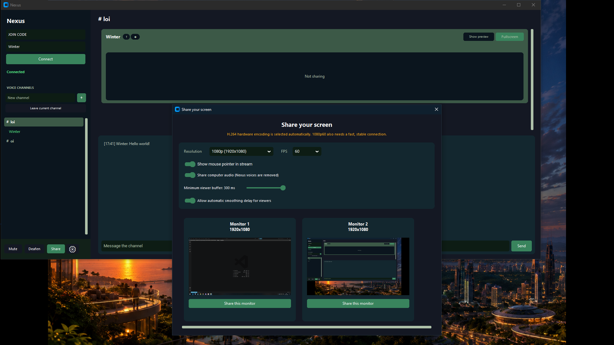
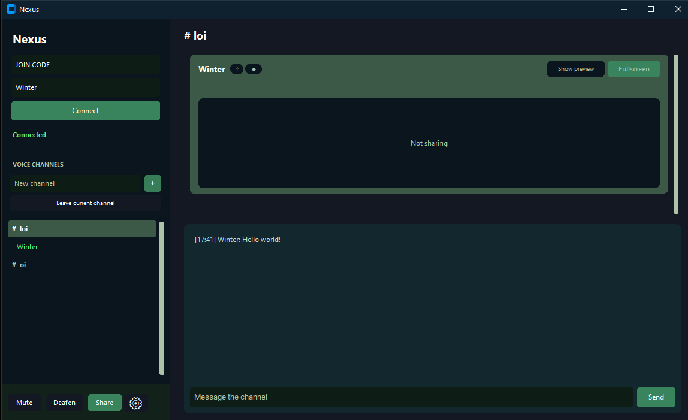
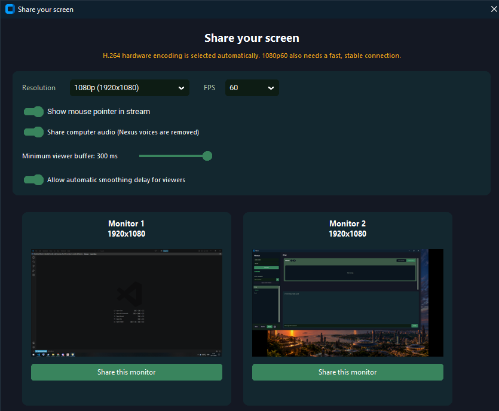
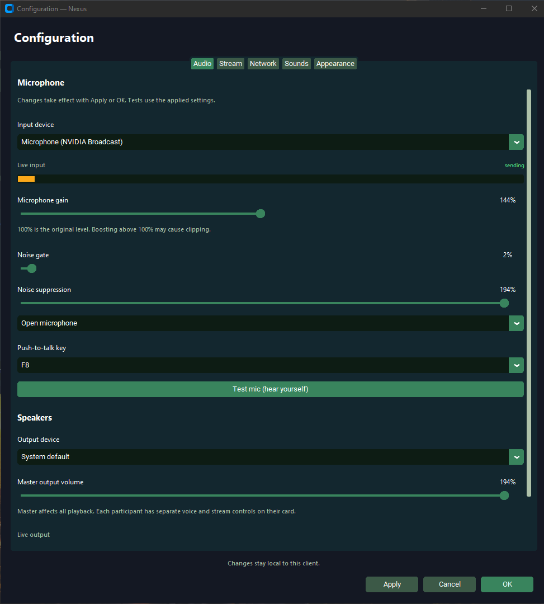
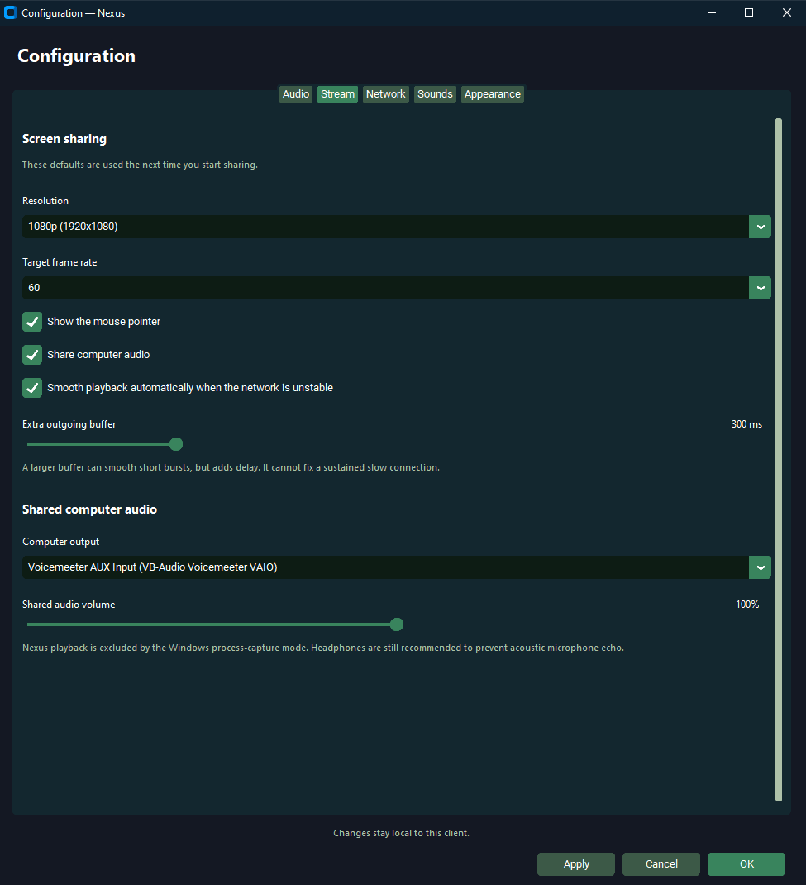
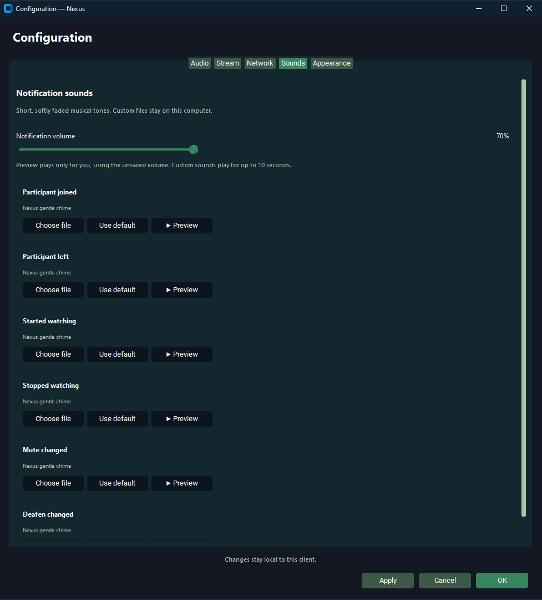
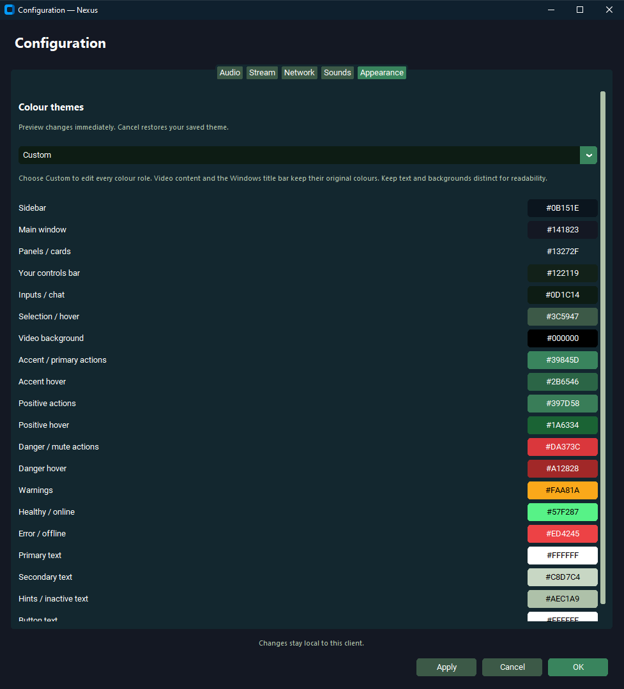

# NEXUS

### *A place to be together, even when we are apart.*

**A private desktop communication platform built by Alexandre & Aline.**

*Built for connection. Designed with care. Made for the people we love.*

---

  
  Real application screenshot • Personal project • Source code remains private

## 💜 Our story

### Two people. One connection. A place of our own.

Some relationships are built around the places two people visit together.

Ours was also built around the places we could share through a screen.

We're **Alexandre and Aline**, and the digital world has always been an important part of our life together. We spend countless hours connected: talking while we work, sharing discoveries, watching things unfold, playing games, laughing at the smallest details, or simply keeping each other company while doing completely different things.

To us, a voice call is not just a call. Sometimes, **it's the closest thing to being in the same room**.

In 2026, restrictions affecting Discord's live video and screen-sharing features in Brazil disrupted a part of that routine. What looked like the loss of a feature from the outside felt very different to us: it meant losing one of the little windows through which we shared our everyday lives.

So we decided to build our own.

**Nexus began with a simple idea: if the tools we relied on could no longer bring us together in the way we needed, we would create a space that could.**

It wasn't born from a business plan, a startup pitch, or a desire to compete with a massive platform. It started with two people who wanted to keep sharing their days, and who happened to love building things.

One feature led to another. Voice. Text. Channels. Screen sharing. Audio controls. A private space for us and the friends who are part of our lives.

And somewhere between technical challenges, late-night fixes, and a ridiculous number of conversations, Nexus became more than a software project.

**It became a small piece of our story, written in code.**

> Technology can bridge a distance. Love gives us a reason to build the bridge.

---

## ✨ What is Nexus?

**Nexus** is a privately developed desktop communication application created for personal use by a small group of friends. It brings everyday communication features together in one interface, with an emphasis on sharing a digital space.

The project demonstrates practical work across desktop UI development, real-time communication, screen capture and sharing, media controls, and client/server workflows.

| Communication | Sharing & control | Experience |
|---|---|---|
| Voice channels | Screen sharing | Dark desktop interface |
| Text chat | Configurable stream resolution and FPS | Server connection flow |
| Small-group spaces | Audio device selection | Self-hosted use |
| Presence and interaction | Microphone and volume controls | Personal, private project |

*Feature descriptions reflect the project as presented in the included screenshots and by its creators; Nexus is not offered here as a public service.*

---

## 🖥️ Inside Nexus

### The communication experience

Our goal was to make conversations and shared moments feel natural. The interface keeps communication, channels, and streaming controls within the same environment.

  

### Getting connected

A communication tool should make it easy to create a place to meet and then get out of the way. Nexus includes connection and server-oriented screens for our private setup.

  

### More from the application

<table>
  <tr>
    <td width="50%" align="center">
      
    </td>
    <td width="50%" align="center">
      
    </td>
  </tr>
  <tr>
    <td width="50%" align="center">
      
    </td>
    <td width="50%" align="center">
      
    </td>
  </tr>
</table>

---

## 🧩 Engineering behind the experience

Nexus gave us an opportunity to work through problems that live at the intersection of several software disciplines:

- **Desktop application design:** building a unified interface for communication, channel navigation, and settings.
- **Real-time communication:** bringing voice conversations and text interaction into a single experience.
- **Screen capture and streaming:** offering options for selecting what to share and controlling stream quality.
- **Audio workflows:** managing microphone and output devices, volume, and noise-related controls.
- **Client/server experience:** organizing the connection workflow for a small, private community.
- **Iterative development:** solving practical problems as we encountered them in everyday use.

The screenshots are a visual showcase, not a complete architecture specification. We have deliberately kept the source code and internal implementation private.

---

## ❤️ Why this project matters

Nexus isn't trying to be everything to everyone.

It exists because sometimes the best reason to create software is neither money nor scale. Sometimes, it's a very specific human need that deserves a very specific solution.

For us, that need was simple:

**To keep a conversation open, to share a screen, to feel present in each other's day, and to never let a missing feature become the reason we felt farther apart.**

That is what Nexus means to us.

---

## 👩‍💻👨‍💻 Created by

**Alexandre Kamimura Paulo** — [AlexWintersky](https://github.com/AlexWintersky)  
**Aline** — Co-creator

*Independently developed as a personal project for our own daily communication and a small circle of friends.*

### Project availability

> **Private software · Public portfolio showcase**  
> This repository contains documentation and screenshots only. It does **not** distribute the application, provide access to a public server, or publish the source code.

Nexus is an independent project and is **not affiliated with Discord**.

---

<strong>🇧🇷 Nossa história — em português</strong>

 

### Duas pessoas, uma conexão e um lugar só nosso

Alguns relacionamentos são construídos nos lugares em que duas pessoas se encontram. O nosso também foi construído nos lugares que conseguimos compartilhar através de uma tela.

Somos **Alexandre e Aline**. Passamos incontáveis horas conectados: conversando enquanto trabalhamos, mostrando descobertas, jogando, rindo de pequenas coisas ou simplesmente fazendo companhia um ao outro, mesmo quando estamos ocupados com atividades completamente diferentes.

Para nós, uma chamada de voz nunca foi apenas uma chamada. Às vezes, é a maneira mais próxima de estarmos no mesmo cômodo.

Quando as restrições às transmissões de vídeo e ao compartilhamento de tela do Discord chegaram ao Brasil em 2026, perdemos uma parte importante dessa rotina. Para muita gente, era apenas uma funcionalidade indisponível. Para nós, era uma das janelas pelas quais dividíamos nossos dias.

Então decidimos construir a nossa própria alternativa.

O **Nexus** não nasceu de um plano de negócios. Nasceu da vontade de continuar juntos no nosso espaço digital. Começou como uma necessidade e cresceu entre conversas, desafios técnicos, tentativas, correções e ideias compartilhadas.

Hoje ele representa algo muito maior do que uma aplicação de voz, texto e compartilhamento de tela.

**É um pequeno pedaço da nossa história, escrito em código.**

> A tecnologia pode encurtar a distância. O amor nos dá um motivo para construir a ponte.

---

**Made with love, persistence, and a lot of shared screen time.**

*Alexandre & Aline · Nexus*

<!-- Context: In 2026, Brazil's ANPD suspended Discord's live-streaming
and related live-video capabilities, not the entire Discord service.
Official source:
https://www.gov.br/anpd/pt-br/assuntos/noticias/conselho-diretor-da-anpd-rejeita-recurso-do-discord-e-mantem-interrupcao-das-transmissoes-ao-vivo-no-brasil
-->
